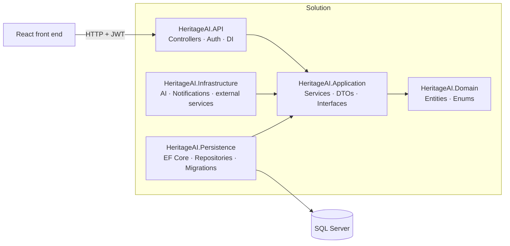

# Ghurza (غُرزة) – Palestinian Embroidery Marketplace

**Ghurza** connects Palestinian *tatreez* (embroidery) artisans directly with customers. A customer can buy a ready-made piece, or start from an idea, explore a design with AI help, pick an artisan and follow the piece until it is delivered.


## Features

**Customers (Buyers)**
- Browse the shop: ready-to-buy and customizable pieces, filtered by category
- Request a custom piece: describe an idea or upload a reference image
- AI-assisted design suggestions inspired by traditional Palestinian patterns
- Choose an artisan, place orders and track their status
- Review products after delivery

**Artisans (Craftsmen)**
- Public profile with their story and their work
- Publish products (reviewed by an admin before going live)
- Receive and manage regular and custom orders from their own dashboard
- Get notified about new orders and admin decisions

**Admins**
- Approve or reject new artisans and new products
- Manage users, categories, orders and testimonials
- Edit site content (home page sections, texts) without touching code

---

## Architecture

The back end follows **Clean Architecture**: dependencies point inwards, and the domain knows nothing about the database or the web.



| Project | Responsibility |
| --- | --- |
| `HeritageAI.Domain` | Entities and enums. No dependencies. |
| `HeritageAI.Application` | Business logic in services (e.g. `AdminProductService`), DTOs and repository interfaces. |
| `HeritageAI.Persistence` | EF Core `DbContext`, repository implementations and migrations. |
| `HeritageAI.Infrastructure` | Integrations such as the AI service and notifications. |
| `HeritageAI.API` | REST controllers, JWT authentication, role-based authorization and dependency injection. |

### Roles and authorization

JWT authentication with three roles. Every endpoint group is protected by role:

| Role | Example endpoints |
| --- | --- |
| **Public** | `PublicProduct`, `PublicCraftsman`, `PublicSiteContent`, `PublicTestimonial`, `Category` |
| **Buyer** | `Order`, `CustomOrder`, `ProductReview`, `Notification` |
| **Craftsman** | `Craftsman`, `CraftsmanOrder`, `CraftsmanCustomOrder`, `Product` |
| **Admin** | `AdminCraftsman`, `AdminProduct`, `AdminOrder`, `AdminUser`, `AdminCategory`, `AdminSiteContent`, `AdminTestimonial` |

---

## Tech stack

**Back end:** ASP.NET Core Web API · C# · Entity Framework Core · SQL Server · JWT · Clean Architecture
**Front end:** React · TypeScript · Arabic RTL interface


---

## Running locally

**Requirements:** .NET 8 SDK, SQL Server (or LocalDB)

1. Clone the repository
   ```bash
   git clone https://github.com/MustafaSalah2001/HeritageAI.git
   cd HeritageAI
   ```
2. Set your connection string and JWT key in `HeritageAI.API/appsettings.Development.json`
   ```json
   {
     "ConnectionStrings": { "DefaultConnection": "Server=.;Database=HeritageAI;Trusted_Connection=True;TrustServerCertificate=True" },
     "Jwt": { "Key": "your-secret-key-at-least-32-characters", "Issuer": "HeritageAI", "Audience": "HeritageAI" }
   }
   ```
3. Create the database
   ```bash
   dotnet ef database update --project HeritageAI.Persistence --startup-project HeritageAI.API
   ```
4. Run the API
   ```bash
   dotnet run --project HeritageAI.API
   ```
   Then open `/swagger` to explore the endpoints.

---

## Author

**Mustafa Salah** – .NET Backend Developer
[LinkedIn](https://www.linkedin.com/in/mustafa-salah-097313294/) · mustafasalah.net@gmail.com
